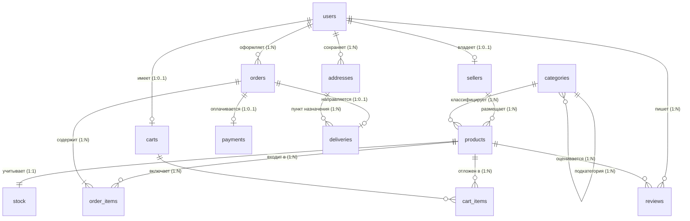

# Отчет по лабораторной работе №1
## «Проектирование и создание структуры базы данных»

**Дисциплина:** Математические основы баз данных / Базы данных  
**Тема:** Концептуальное, логическое и физическое проектирование реляционной схемы базы данных в СУБД PostgreSQL  
**Среда выполнения:** PostgreSQL 15+, pgAdmin 4  
**Сквозной проект:** База данных маркетплейса (Marketplace)  

---

## 1. Цель работы
Изучить принципы проектирования реляционных баз данных: от анализа предметной области и формулирования бизнес-правил до построения концептуальной и логической моделей данных (ER-диаграмм). Освоить процесс реляционной нормализации до уровня 3-й нормальной формы (3НФ) и устранения аномалий модификации. Научиться реализовывать физическую схему базы данных средствами языка DDL (Data Definition Language) в СУБД PostgreSQL с использованием суррогатных первичных ключей (`IDENTITY`), внешних ключей (`FOREIGN KEY`), декларативных ограничений целостности (`NOT NULL`, `UNIQUE`, `CHECK`, `DEFAULT`) и правил ссылочной целостности (`ON DELETE`, `ON UPDATE`).

---

## 2. Техническое задание
1. Провести анализ предметной области и сформулировать перечень бизнес-правил площадки (маркетплейса).
2. Построить ER-диаграмму, включающую не менее 10 сущностей. Схема должна содержать хотя бы одну связь «многие-ко-многим» ($M:N$) через ассоциативную таблицу и хотя бы одну иерархическую связь (самоссылку).
3. Привести схему к третьей нормальной форме (3НФ). На примере одной таблицы показать аномалии вставки, обновления и удаления до нормализации и пояснить, как они устранены.
4. Определить для каждой таблицы первичный ключ; обосновать выбор суррогатных ключей.
5. Реализовать схему в PostgreSQL средствами DDL: создать таблицы с типами данных, первичными и внешними ключами, ограничениями целостности и политиками каскадирования.
6. Составить словарь данных: для каждой таблицы перечислить столбцы, их типы, ограничения и назначение.
7. Оформить команды единым воспроизводимым SQL-скриптом.
8. Подготовить развёрнутые ответы на 10 контрольных вопросов.

---

## 3. Анализ предметной области и бизнес-правила

Маркетплейс представляет собой многопользовательскую цифровую платформу электронной коммерции, объединяющую независимых продавцов (магазины) и розничных покупателей.

### Сформулированные бизнес-правила:
1. **Пользователи и аккаунты:** Каждый пользователь платформы (`users`) регистрируется с уникальным адресом электронной почты (`email`). Пользователь может выступать в роли покупателя (`customer`), владельца магазина (`seller`) или администратора (`admin`).
2. **Продавцы:** Один пользователь может зарегистрировать не более одного магазина (`sellers`, связь $1:1$). Магазин обязательно привязан к существующему владельцу.
3. **Каталог товаров и иерархия:** Категории товаров (`categories`) образуют древовидную иерархию (список смежности: `parent_id` ссылается на `id` родительской категории). У корневых разделов `parent_id IS NULL`. Удаление категории запрещено при наличии дочерних (`ON DELETE RESTRICT`).
4. **Товары:** Каждый товар (`products`) принадлежит ровно одному продавцу и отнесён ровно к одной конечной категории каталога. Цена товара обязана быть строго положительной (`price > 0`). Товар имеет статус активности (`is_active`).
5. **Складской учёт:** Для каждого товара поддерживается учёт доступного остатка (`stock`). Количество единиц не может быть отрицательным (`quantity >= 0`).
6. **Корзина:** У пользователя может быть только одна активная корзина (`carts`). Корзина содержит позиции (`cart_items`), связывающие корзину с товарами с указанием положительного количества.
7. **Заказы и позиции:** Заказ (`orders`) оформляется покупателем. Связь между заказом и товарами реализуется по схеме «многие-ко-многим» через промежуточную ассоциативную таблицу позиций заказа (`order_items`). В позициях заказа фиксируется `unit_price` — исторический слепок цены на момент оформления.
8. **Оплата:** Заказ оплачивается через платеж (`payments`, связь $1:1$). Сумма платежа неотрицательна.
9. **Отзывы:** Покупатель может оставить оценку (от 1 до 5) и текстовый отзыв (`reviews`) к приобретенному товару. Удаление товара или пользователя каскадно удаляет отзыв.
10. **Доставка:** Заказ доставляется курьерской службой (`deliveries`) по одному из сохраненных адресов пользователя (`addresses`).

---

## 4. ER-моделирование предметной области

### 4.1. Диаграмма «Сущность — Связь» (ER-диаграмма)



### 4.2. Характеристика связей схемы:
- **Связь «многие-ко-многим» ($M:N$):** Сущности `orders` и `products` связаны через ассоциативную таблицу `order_items` с составным первичным ключом `(order_id, product_id)`.
- **Иерархическая связь (самоссылка):** Сущность `categories` ссылается на саму себя по полю `parent_id -> categories(id)`.
- **Связи «один-к-одному» ($1:1$):** `users` $\leftrightarrow$ `sellers`, `orders` $\leftrightarrow$ `payments`, `orders` $\leftrightarrow$ `deliveries`, `products` $\leftrightarrow$ `stock`.
- **Связи «один-ко-многим» ($1:N$):** `sellers` $\to$ `products`, `users` $\to$ `orders`, `categories` $\to$ `products`, `users` $\to$ `addresses`.

---

## 5. Нормализация данных и устранение аномалий

Спроектированная схема приведена к **третьей нормальной форме (3НФ)**.

### 5.1. Анализ нормальных форм
1. **1НФ (Первая нормальная форма):** Все атрибуты атомарны. Отсутствуют повторяющиеся группы или списки в одной ячейке (например, список товаров заказа вынесен из таблицы `orders` в ассоциативную таблицу `order_items`).
2. **2НФ (Вторая нормальная форма):** Схема находится в 1НФ, и каждый неключевой атрибут функционально полно зависит от всего первичного ключа. В таблице `order_items` с составным ключом `(order_id, product_id)` цена `unit_price` и количество `quantity` зависят от комбинации обоих ключей. Название товара и имя продавца вынесены в `products`, предотвращая частичную зависимость.
3. **3НФ (Третья нормальная форма):** Схема находится в 2НФ, и отсутствуют транзитивные функциональные зависимости неключевых атрибутов. Например, данные магазина продавца вынесены в `sellers`, а не дублируются в `products`.

### 5.2. Пример аномалий до нормализации и их устранение
Рассмотрим гипотетическую ненормализованную таблицу до декомпозиции:
`unnormalized_orders (order_id, product_id, product_title, seller_id, seller_name, seller_phone, unit_price, quantity)`

В такой таблице возникают классические аномалии:
- **Аномалия вставки (Insertion Anomaly):** Невозможно внести в базу нового продавца или новый товар до тех пор, пока на него не будет оформлен хотя бы один заказ.
- **Аномалия обновления (Update Anomaly):** Если продавец изменяет контактный телефон (`seller_phone`), его придется обновлять в тысячах исторических заказов. При пропуске хотя бы одной строки данные окажутся рассогласованными.
- **Аномалия удаления (Deletion Anomaly):** Если удаляется единственный заказ покупателя, вместе с ним безвозвратно удаляются сведения о товаре и продавце.

**Решение (устранение аномалий):**  
Проведена декомпозиция без потерь (Lossless Decomposition) на три независимых отношения:
1. `sellers (id, shop_name, ...)` — хранит независимые данные магазина;
2. `products (id, seller_id, title, ...)` — хранит карточку товара;
3. `order_items (order_id, product_id, quantity, unit_price)` — фиксирует только факт вхождения товара в заказ.

---

## 6. Обоснование выбора первичных ключей

Для всех сущностей схемы (за исключением ассоциативной таблицы `order_items`) в качестве первичных ключей выбраны **суррогатные ключи** на базе типа `BIGINT GENERATED ALWAYS AS IDENTITY`.

**Преимущества выбора суррогатных ключей:**
1. **Стабильность (Immutability):** Искусственные идентификаторы не содержат предметного смысла и никогда не меняются в ходе жизненного цикла записи. Естественные ключи (такие как `email`, телефон, артикул, ИНН) могут изменяться вследствие ребрендинга, смены почты или ошибки ввода оператора, что вызвало бы каскадное обновление миллионов внешних ключей.
2. **Компактность и скорость:** Целочисленный тип `BIGINT` (8 байт) фиксированной длины обеспечивает максимальную производительность при построении B-tree индексов и соединении таблиц (`JOIN`), опережая строковые естественные ключи (`VARCHAR`).
3. **Стандарт SQL:** Конструкция `GENERATED ALWAYS AS IDENTITY` является стандартной спецификацией SQL:2003+ в PostgreSQL, гарантирующей защиту от случайной ручной вставки дублирующих номеров в автоинкремент.

Для таблицы связки `order_items` применен естественный **составной первичный ключ** `PRIMARY KEY (order_id, product_id)`, гарантирующий, что один и тот же товар не может появиться в одном заказе более одного раза отдельной строкой.

---

## 7. Словарь данных (Data Dictionary)

| Таблица | Столбец | Тип данных | Ограничения | Назначение |
| :--- | :--- | :--- | :--- | :--- |
| **users** | `id` | BIGINT | PK, IDENTITY | Идентификатор пользователя |
| | `full_name` | VARCHAR(100) | NOT NULL | Полное имя (ФИО) |
| | `email` | VARCHAR(150) | NOT NULL, UNIQUE | Уникальный email / логин |
| | `phone` | VARCHAR(20) | | Контактный телефон |
| | `password_hash` | VARCHAR(255) | NOT NULL | Хэш пароля |
| | `role` | VARCHAR(20) | DEFAULT 'customer', CHECK | Роль пользователя |
| | `created_at` | TIMESTAMP | DEFAULT CURRENT_TIMESTAMP | Дата регистрации |
| **sellers** | `id` | BIGINT | PK, IDENTITY | Идентификатор магазина |
| | `user_id` | BIGINT | NOT NULL, UNIQUE, FK users(id) ON DELETE CASCADE | Владелец магазина |
| | `shop_name` | VARCHAR(150) | NOT NULL | Название магазина |
| | `description` | TEXT | | Описание магазина |
| | `created_at` | TIMESTAMP | DEFAULT CURRENT_TIMESTAMP | Дата создания |
| **categories** | `id` | BIGINT | PK, IDENTITY | Идентификатор категории |
| | `parent_id` | BIGINT | FK categories(id) ON DELETE RESTRICT | Родительская категория (дерево) |
| | `name` | VARCHAR(100) | NOT NULL, UNIQUE | Наименование категории |
| **products** | `id` | BIGINT | PK, IDENTITY | Идентификатор товара |
| | `seller_id` | BIGINT | NOT NULL, FK sellers(id) ON DELETE RESTRICT | Продавец товара |
| | `category_id` | BIGINT | NOT NULL, FK categories(id) ON DELETE RESTRICT | Категория товара |
| | `title` | VARCHAR(200) | NOT NULL | Название товара |
| | `description` | TEXT | | Описание товара |
| | `price` | NUMERIC(12,2) | NOT NULL, CHECK (price > 0) | Цена товара (руб.) |
| | `is_active` | BOOLEAN | DEFAULT TRUE | Признак активности в каталоге |
| | `created_at` | TIMESTAMP | DEFAULT CURRENT_TIMESTAMP | Дата размещения |
| **stock** | `id` | BIGINT | PK, IDENTITY | Идентификатор остатка |
| | `product_id` | BIGINT | NOT NULL, UNIQUE, FK products(id) ON DELETE CASCADE | Ссылка на товар |
| | `quantity` | INTEGER | NOT NULL, CHECK (quantity >= 0) | Доступный остаток на складе |
| | `updated_at` | TIMESTAMP | DEFAULT CURRENT_TIMESTAMP | Время изменения |
| **carts** | `id` | BIGINT | PK, IDENTITY | Идентификатор корзины |
| | `user_id` | BIGINT | NOT NULL, UNIQUE, FK users(id) ON DELETE CASCADE | Владелец корзины |
| | `created_at` | TIMESTAMP | DEFAULT CURRENT_TIMESTAMP | Время создания |
| **cart_items** | `id` | BIGINT | PK, IDENTITY | Идентификатор позиции корзины |
| | `cart_id` | BIGINT | NOT NULL, FK carts(id) ON DELETE CASCADE | Ссылка на корзину |
| | `product_id` | BIGINT | NOT NULL, FK products(id) ON DELETE RESTRICT | Отложенный товар |
| | `quantity` | INTEGER | NOT NULL, CHECK (quantity > 0) | Количество товара |
| **orders** | `id` | BIGINT | PK, IDENTITY | Номер заказа |
| | `user_id` | BIGINT | NOT NULL, FK users(id) ON DELETE RESTRICT | Покупатель |
| | `status` | VARCHAR(30) | DEFAULT 'created', CHECK | Статус жизненного цикла заказа |
| | `total_amount` | NUMERIC(12,2) | DEFAULT 0.00, CHECK (total_amount >= 0) | Сумма заказа |
| | `created_at` | TIMESTAMP | DEFAULT CURRENT_TIMESTAMP | Время оформления |
| **order_items**| `order_id` | BIGINT | PK, FK orders(id) ON DELETE CASCADE | Номер заказа |
| | `product_id` | BIGINT | PK, FK products(id) ON DELETE RESTRICT | Номер товара |
| | `quantity` | INTEGER | NOT NULL, CHECK (quantity > 0) | Количество в заказе |
| | `unit_price` | NUMERIC(12,2) | NOT NULL, CHECK (unit_price > 0) | Фиксированная цена продажи |
| **payments** | `id` | BIGINT | PK, IDENTITY | Идентификатор платежа |
| | `order_id` | BIGINT | NOT NULL, UNIQUE, FK orders(id) ON DELETE CASCADE | Оплачиваемый заказ |
| | `amount` | NUMERIC(12,2) | NOT NULL, CHECK (amount >= 0) | Сумма платежа |
| | `payment_status`| VARCHAR(30) | DEFAULT 'waiting', CHECK | Статус платежа |
| | `paid_at` | TIMESTAMP | | Время проведения оплаты |
| **reviews** | `id` | BIGINT | PK, IDENTITY | Идентификатор отзыва |
| | `user_id` | BIGINT | NOT NULL, FK users(id) ON DELETE CASCADE | Автор отзыва |
| | `product_id` | BIGINT | NOT NULL, FK products(id) ON DELETE CASCADE | Оцениваемый товар |
| | `rating` | INTEGER | NOT NULL, CHECK (rating BETWEEN 1 AND 5) | Балл (оценка) |
| | `comment` | TEXT | | Текст комментария |
| | `created_at` | TIMESTAMP | DEFAULT CURRENT_TIMESTAMP | Время публикации |
| **addresses** | `id` | BIGINT | PK, IDENTITY | Идентификатор адреса |
| | `user_id` | BIGINT | NOT NULL, FK users(id) ON DELETE CASCADE | Пользователь |
| | `city` | VARCHAR(100) | NOT NULL | Город |
| | `street` | VARCHAR(150) | NOT NULL | Улица |
| | `house` | VARCHAR(20) | NOT NULL | Дом |
| | `apartment` | VARCHAR(20) | | Квартира / офис |
| **deliveries** | `id` | BIGINT | PK, IDENTITY | Идентификатор доставки |
| | `order_id` | BIGINT | NOT NULL, UNIQUE, FK orders(id) ON DELETE CASCADE | Доставляемый заказ |
| | `address_id` | BIGINT | NOT NULL, FK addresses(id) ON DELETE RESTRICT | Целевой адрес |
| | `delivery_status`| VARCHAR(30)| DEFAULT 'created', CHECK | Статус доставки |
| | `delivery_date`| TIMESTAMP | | Время вручения |

---

## 8. Реализация схемы на языке DDL (SQL)

Схема базы данных создана с полным соблюдением ссылочной целостности и правил каскадирования (`ON DELETE CASCADE` для подчиненных зависимых сущностей и `ON DELETE RESTRICT` для критических мастер-данных).

**Фрагмент DDL скрипта (создание ключевых таблиц):**
```sql
CREATE TABLE categories (
    id BIGINT GENERATED ALWAYS AS IDENTITY PRIMARY KEY,
    parent_id BIGINT REFERENCES categories(id) ON DELETE RESTRICT ON UPDATE CASCADE,
    name VARCHAR(100) UNIQUE NOT NULL
);

CREATE TABLE products (
    id BIGINT GENERATED ALWAYS AS IDENTITY PRIMARY KEY,
    seller_id BIGINT NOT NULL REFERENCES sellers(id) ON DELETE RESTRICT ON UPDATE CASCADE,
    category_id BIGINT NOT NULL REFERENCES categories(id) ON DELETE RESTRICT ON UPDATE CASCADE,
    title VARCHAR(200) NOT NULL,
    description TEXT,
    price NUMERIC(12,2) NOT NULL CHECK (price > 0),
    is_active BOOLEAN DEFAULT TRUE,
    created_at TIMESTAMP DEFAULT CURRENT_TIMESTAMP
);

CREATE TABLE order_items (
    order_id BIGINT NOT NULL REFERENCES orders(id) ON DELETE CASCADE ON UPDATE CASCADE,
    product_id BIGINT NOT NULL REFERENCES products(id) ON DELETE RESTRICT ON UPDATE CASCADE,
    quantity INTEGER NOT NULL CHECK (quantity > 0),
    unit_price NUMERIC(12,2) NOT NULL CHECK (unit_price > 0),
    PRIMARY KEY (order_id, product_id)
);
```

**Результат верификации схемы в СУБД (13 созданных таблиц):**
| table_name | column_count |
| :--- | :--- |
| addresses | 6 |
| cart_items | 4 |
| carts | 3 |
| categories | 3 |
| deliveries | 5 |
| order_items | 4 |
| orders | 5 |
| payments | 5 |
| products | 8 |
| reviews | 6 |
| sellers | 5 |
| stock | 4 |
| users | 7 |

---

## 9. Ответы на контрольные вопросы

### 1. Что такое реляционная модель данных и что в ней называют отношением, кортежем и атрибутом?
Реляционная модель данных (предложена Э. Коддом в 1970 г.) представляет данные в виде совокупности взаимосвязанных двумерных математических отношений.  
- **Отношение (Relation):** подмножество декартова произведения доменов; на практике — это реляционная таблица, обладающая уникальным именем.
- **Кортеж (Tuple):** элемент отношения, представляющий одну строку таблицы (запись), описывающую единичный объект реального мира.
- **Атрибут (Attribute):** именованный столбец отношения, описывающий конкретное элементарное свойство сущности и принимающий значения из заданного домена (типа данных).

### 2. Чем отличаются концептуальная, логическая и физическая модели данных?
- **Концептуальная модель:** описывает высокоуровневые сущности предметной области и связи между ними без технической детализации и независима от типа СУБД (бизнес-модель).
- **Логическая модель:** детализирует атрибуты сущностей, кардинальность связей ($1:1$, $1:N$, $M:N$), первичные и потенциальные ключи, нормализует отношения, но остается независимой от конкретной СУБД.
- **Физическая модель:** адаптирует логическую схему под диалект конкретной СУБД (PostgreSQL), включая точные типы данных (`NUMERIC`, `BIGINT`, `TIMESTAMP`), специфические ограничения (`CHECK`, `IDENTITY`), параметры хранения, таблицы индексов и схемы безопасности.

### 3. Что такое первичный ключ и какие требования к нему предъявляются?
Первичный ключ (`PRIMARY KEY`) — минимальный набор атрибутов, однозначно идентифицирующий каждый кортеж отношения.  
Требования к первичному ключу:
1. **Уникальность:** в таблице не может существовать двух строк с одинаковым значением ключа;
2. **Обязательность (NOT NULL):** значение ключа всегда определено и не может быть `NULL`;
3. **Стабильность (Immutability):** значение ключа не должно изменяться на протяжении всей жизни записи;
4. **Минимальность:** ключ не должен содержать избыточных атрибутов, удаление любого из которых нарушило бы однозначность идентификации.

### 4. В чём различие между суррогатным и естественным ключом? Каковы их достоинства и недостатки?
- **Естественный ключ:** сформирован из реальных бизнес-атрибутов сущности (email, паспорт, ИНН, VIN-номер).
  - *Плюсы:* наглядность, отсутствие необходимости соединений для понимания идентификатора.
  - *Минусы:* нестабилен (бизнес-правила и данные в реальном мире меняются), строковые ключи занимают больше места и замедляют индексы.
- **Суррогатный ключ:** искусственно синтезированное уникальное число (`BIGINT IDENTITY` или `UUID`), не имеющее физического смысла вне базы данных.
  - *Плюсы:* компактен, максимальная скорость в индексах и `JOIN`, 100% стабильность (никогда не изменяется).
  - *Минусы:* требует соединений с таблицей-справочником для чтения информации человеком.

### 5. Что такое внешний ключ и как он обеспечивает ссылочную целостность?
Внешний ключ (`FOREIGN KEY`) — атрибут дочерней таблицы, значения которого ссылаются на первичный (или уникальный) ключ родительской таблицы.  
Внешний ключ гарантирует ссылочную целостность (Referential Integrity): СУБД блокирует добавление дочерней записи с несуществующим родителем (например, товар без продавца), а также автоматически обрабатывает удаление или изменение родительской строки в соответствии с правилами `ON DELETE` и `ON UPDATE`.

### 6. Как в реляционной модели реализуется связь «многие-ко-многим»?
Связь «многие-ко-многим» ($M:N$) не может быть выражена напрямую парой таблиц. Она реализуется через **ассоциативную (промежуточную/соединительную) таблицу**, которая декомпозирует $M:N$ на две связи «один-ко-многим» ($1:N$). Ассоциативная таблица содержит два внешних ключа на обе связываемые сущности. Первичным ключом ассоциативной таблицы обычно служит составной ключ из этих двух внешних ключей (например, `PRIMARY KEY (order_id, product_id)` в таблице `order_items`).

### 7. Как смоделировать иерархические данные (дерево категорий) одной таблицей?
Иерархические данные моделируются с помощью шаблона **«список смежности» (Adjacency List)**. В таблицу добавляется столбец самоссылки `parent_id`, который является внешним ключом на `id` этой же таблицы (`FOREIGN KEY (parent_id) REFERENCES categories(id)`). Корневые узлы дерева имеют значение `parent_id = NULL`, а узлы подкатегорий содержат `id` своего родителя. Обход такого дерева на любую глубину выполняется с помощью рекурсивного общего табличного выражения (`WITH RECURSIVE`).

### 8. Какие ограничения целостности поддерживает PostgreSQL и что задаёт каждое из них?
1. `PRIMARY KEY` — гарантирует уникальность и запрет `NULL` для идентификации строки;
2. `FOREIGN KEY` — контролирует ссылочную целостность между связанными таблицами;
3. `NOT NULL` — запрещает отсутствие значения в столбце;
4. `UNIQUE` — гарантирует уникальность всех не-NULL значений в столбце или группе столбцов;
5. `CHECK` — проверяет истинность произвольного логического предиката (например, `price > 0`, `quantity >= 0`);
6. `DEFAULT` — подставляет значение по умолчанию, если оно не было явно передано при вставке строки.

### 9. Что такое нормализация и какие аномалии она устраняет? Сформулируйте требования 1НФ, 2НФ и 3НФ.
Нормализация — метод проектирования схемы базы данных, устраняющий избыточность данных и аномалии модификации (вставки, обновления и удаления).
- **1НФ:** все атрибуты атомарны, отсутствуют повторяющиеся группы.
- **2НФ:** находится в 1НФ, и каждый неключевой атрибут функционально полно зависит от составного первичного ключа.
- **3НФ:** находится в 2НФ, и отсутствуют транзитивные зависимости (неключевой атрибут не зависит от другого неключевого атрибута).

### 10. Для чего нужны правила ON DELETE RESTRICT и ON DELETE CASCADE и чем они различаются?
Они определяют реакцию СУБД при попытке удаления родительской записи:
- `ON DELETE RESTRICT` (и аналогичный `NO ACTION`): **запрещает удаление** родительской строки, если на неё ссылается хотя бы одна дочерняя строка, генерируя ошибку. Применяется для защиты критических данных: нельзя удалить товар, пока он входит в оформленные заказы.
- `ON DELETE CASCADE`: **автоматически удаляет** все зависимые дочерние строки вслед за удалением родителя. Применяется для жестко подчиненных сущностей: удаление заказа каскадно удаляет его позиции (`order_items`), доставку и платеж.

---

## 10. Выводы
В ходе выполнения лабораторной работы №1 была полностью спроектирована и реализована реляционная схема базы данных маркетплейса, состоящая из 13 взаимосвязанных таблиц. Схема нормализована до 3НФ, исключает аномалии модификации, содержит связь $M:N$, иерархическую связь и корректные политики каскадирования, обеспечивая надёжный фундамент для последующих лабораторных работ практикума.
